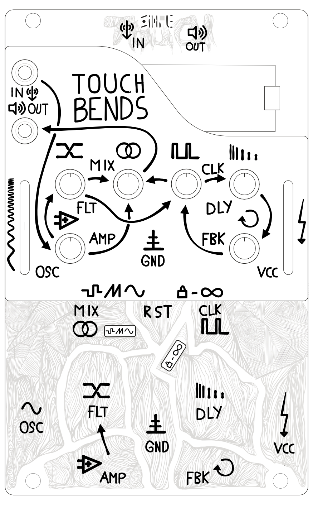

# TouchBends: Circuit Bending Laboratory
**by Vincent Maurer**

TouchBends is a virtual circuit bending laboratory for the **Synthux Touch 2** platform, running on the Electro-Smith Daisy Seed.

It is a lo-fi delay that can be bent with your fingers from chorus to glitchy looper and nasty distortion, everything is possible. Bridge the touch contacts with your fingers to short, starve, and corrupt the audio circuit. It can be played on its own or with audio feeding the delay line.

---

## What is Virtual Circuit Bending?

Pioneered by Reed Ghazala in the 1960s, circuit bending is the art of deliberately shorting and altering electronic circuits (like toy keyboards, drum machines, and samplers) to discover unexpected sonic failures.

TouchBends brings this practice into the Touch: every pad is an exposed circuit node, and your skin acts as the variable resistor. You get all the tactile chaos, voltage sag, and serendipitous discovery, without ever letting out the magic smoke!

---

## Controls



### Knobs
- **AMP**: Input volume and preamp drive.
- **FLT**: Low-pass / high-pass filter cutoff (low-pass CCW, flat bypass at noon, high-pass CW).
- **MIX**: Dry / wet mix balance.
- **CLK**: Delay sample rate and speed (varispeed: crunchy lo-fi downclock up to 2x speed).
- **DLY**: Delay line length (tight comb filtering up to multi-second echoes).
- **FBK**: Feedback amount (repeats into runaway saturation).

### Faders
- **OSC (Left)**: Bending oscillator pitch (from slow LFO sweeps to audio rate).
- **VCC (Right)**: Circuit voltage. Slide down to starve the virtual battery into brownout.

### Switches
- **Waveform (Left / Switch A)**:
  - **Up**: Sine wave
  - **Center**: Sawtooth wave
  - **Down**: Stepped Random (chaotic sample and hold loops)
- **Play Mode (Right / Switch B)**:
  - **Up (Freeze)**: Locks delay buffer recording and loops captured audio.
  - **Center (Live)**: Momentary touch response. Bends release when fingers lift.
  - **Down (Latch)**: "Solders" active bends so they stay latched hands-free.

---

## Touch Pads & Circuit Nodes

The 12 capacitive touch pads on the panel act as test points and circuit pins:

```text
                 [ IN ]                       [ OUT ]

                                 [ RST ]
                     [ MIX ]                 [ CLK ]

       [ OSC ]       [ FLT ]                 [ DLY ]       [ VCC ]

                     [ AMP ]     [ GND ]     [ FBK ]
```

### How to Bend

Bridge two or more pads with your fingers or conductive objects like coins. **The firmer you press, the lower the contact resistance and the stronger the connection.**

Every pad corresponds to an exposed part of the circuit (see the diagram above). All connections will do something: you can modulate the filter or delay speed with the bending oscillator, feed the output back into the amp, or crash the circuit by grounding the voltage.

* **Top Logo Pads (IN & OUT)**: Expose the audio input and output nodes. The **IN** pad also doubles as an acoustic contact mic (tap, rub, or scrape it with your fingernails!). Bridging **IN + OUT** creates direct no-input feedback loops.
* **RST (Reset Pad)**: Exposes the memory reset bus. Bridging **RST + GND** instantly flushes the delay memory.

## The Power Rail & Oscillator

- **VCC (Right Fader)**: Circuit voltage. Slide it down to starve the virtual battery. The preamp will saturate faster, repeats will get crunchy and start skipping, and at the bottom the circuit browns out. All bends pull from this same power rail: the more pads you touch, the more the voltage sags!
- **OSC (Left Fader & Switch A)**: A bending oscillator that sweeps from slow pulses up to audio rate. Switch A picks Sine (up), Saw (center), or Stepped Random (down). It is silent until you bend it into the circuit.

---

## Exploring the Bends

Try these in order to get a feel for the instrument:

### 1. The Bending Oscillator
Bridge **OSC + AMP** to hear the oscillator through the preamp.
- Move the **OSC** fader to sweep pitch from slow clicks to high tones.
- Flip **Switch A** to compare Sine, Saw, and Stepped Random.
- Turn up **AMP** to overdrive it into warm saturation or harsh distortion.

### 2. Shaping with the Filter
- **OSC + FLT**: Modulates the filter cutoff with the oscillator for vocal, buzzing tones.
- **OSC + AMP + FLT (Switch A Down)**: Put the oscillator in Stepped Random and turn the OSC fader down low. This pings the resonant filter in generative melodic sequences like a modular sample and hold.

### 3. Modulating Delay
- **OSC + CLK**: Modulates delay clock for pitch vibrato, chorus, and FM sidebands.
- **OSC + DLY**: Modulates delay time based on the oscillator waveform:
  - **Saw**: Granular scrubbing (tape scrub at low speeds, grain clouds at high speeds).
  - **Sine**: Smooth back-and-forth delay time sweep.
  - **Stepped Random**: Rhythmic stutter and random tap jumps.

### 4. Bending External Audio & Delay
Plug in a synth or drum machine (or tap the **IN** pad), and turn up **MIX**, **DLY**, and **FBK**:
- **CLK + GND**: Pulls the clock to ground. Decelerates delay repeats into crunchy lo-fi grit; release to snap back to tempo.
- **CLK + DLY**: Chops the delay line with the clock into rhythmic stutters.
- **DLY + VCC**: Connects the delay to high voltage for an octave-up shimmer. Press firmly to scatter memory repeats.
- **DLY + FBK**: Glitches the buffer into runaway feedback and micro-loops.
- **DLY + GND**: Corrupts delay memory into bitcrush and address skips.
- **IN + OUT**: Direct no-input feedback loop. Sculpt the squeal with **AMP** and **FLT**.

### 5. Acoustic String Resonator
Turn **DLY** down short (counter-clockwise) and **FBK** past 2 o'clock. Tap the **IN** pad or send in drums to turn the delay into a plucked acoustic string. Modulate the pitch with **OSC + CLK**!

### 6. Reverse & Reset
- **CLK + RST**: Reverses delay playback backward through memory while writes are frozen.
- **RST + GND**: Instantly flushes the delay buffer clean.

---

You can bend as many pads together as your hands can reach, circuit bending is all about exploration. Try unexpected combinations, play with the knobs, oscillator waveforms, and feedback (just watch out, it might get a little loud!).

---

## Building and Flashing

### Requirements
- `arm-none-eabi-gcc` (10.3+ or 14.x recommended)
- `make`
- `dfu-util`

### Setup & Compilation

```bash
# 1. Clone repository with submodules
git clone --recursive -b beta https://github.com/vincentltm/TouchBends.git
cd TouchBends

# 2. Initialize submodules and apply DaisySeed patches
make setup-libs

# 3. Build firmware
make -j8

# 4. Flash to Daisy Seed
# Hold BOOT button on Daisy Seed, press RESET, then release BOOT
make program-dfu
```

### Running Host Unit Tests
To test the delay engine and bend matrix locally on your machine (macOS/Linux):
```bash
make test
```

## Technical Architecture & DSP

For in-depth documentation covering the embedded architecture, virtual circuit solver, DSP signal blocks, and diagnostic profiling tools, see [manual/technical_reference.md](manual/technical_reference.md).

## License

MIT License. See [LICENSE](LICENSE) for details.  
Copyright (c) 2026 Vincent Maurer.
